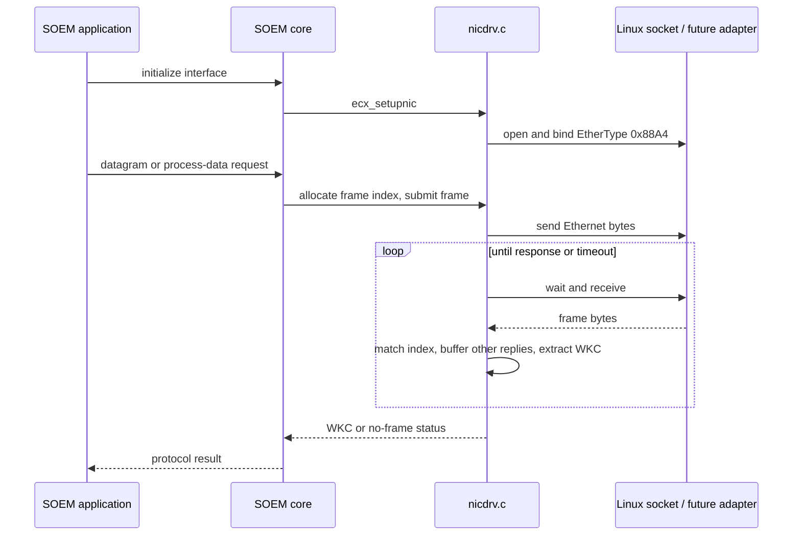

# Experiment 5A — SOEM Linux networking and the seL4 boundary

Date: 2026-11-04. Scope: source investigation and host build checks.
No seL4 network adapter is implemented by this experiment.

In plain English: SOEM already knows EtherCAT. We are locating the places
where it asks Linux to send a frame, receive a frame, or wait. Later we will
supply those services using sDDF while preserving SOEM's protocol behavior.

## Sources actually inspected

- [SOEM 49fc34923b973c17700592319159af22157350c9](https://github.com/OpenEtherCATsociety/SOEM/tree/49fc34923b973c17700592319159af22157350c9),
  resolving the handoff's `49fc349`. CMake declares SOEM 2.0.0.
- [sDDF 4b47a3534b136e240fbad970aec277adc4d65fe7](https://github.com/au-ts/sddf/tree/4b47a3534b136e240fbad970aec277adc4d65fe7),
  the revision fetched for this audit. Its README lists Microkit SDK 2.4.0.
  This is an inspected candidate, not a built/qualified integration dependency.
- Project main `85c925705cfa42000c978275e1081ad265726dc1`; see the
  [repository review](repository-map.md) for completed experiments and limits.

Do not substitute APIs from old SOEM tutorials. Dependencies are separate
checkouts; upstream code has not been copied into or modified by this project.

## Call path

Non-process-data calls in `src/ec_base.c` use `ecx_getindex`, construct the
datagram, call `ecx_srconfirm`, and release the index. Process-data send/receive
in `src/ec_main.c` use `ecx_outframe_red` and `ecx_waitinframe` separately.
Initialization/close enter through `ecx_init`/`ecx_close` in `ec_main.c`.

## Function-to-platform mapping

All line references below use the pinned
[Linux nicdrv.c](https://github.com/OpenEtherCATsociety/SOEM/blob/49fc34923b973c17700592319159af22157350c9/oshw/linux/nicdrv.c).
Proposed seL4 behavior is design work, not a tested implementation.

| Function / source line | Verified Linux behavior | Required seL4/sDDF adaptation |
|---|---|---|
| `ecx_setupnic`, 92 | Initializes indexed buffers and priority-inheritance mutexes; opens `PF_PACKET/SOCK_RAW` for 0x88A4; looks up interface index with ioctl, sets promiscuous/broadcast flags, binds. Returns 1 on success, 0 on failure. | Initialize configured queue/memory/channel resources; validate capacities and link configuration. No Linux interface-name lookup or socket. Report resource failures explicitly. |
| `ecx_closenic`, 191 | Closes primary and optional secondary sockets, returns 0. Does not restore interface flags or destroy these mutexes. | Stop submissions and resolve/reclaim outstanding owned buffers before teardown; do not free buffers still owned by the driver. |
| `ec_setupheader`, 206 | Broadcast destination, configured source MAC, EtherType 0x88A4. Source MAC is a routing marker, not the NIC's discovered address. | Preserve Ethernet bytes and redundancy markers; check NIC/filter acceptance. |
| `ecx_getindex` / `ecx_setbufstat`, 223/262 | Allocates/changes indexed RX state; default 16 buffers; allocation scan is bounded but does not provide an exhaustion error. | Keep SOEM index bookkeeping distinct from sDDF descriptor ownership. Define backpressure before exhausting outstanding slots. |
| `ecx_outframe`, 275 | Marks slot TX, calls `send(..., length, 0)`, returns socket result; on -1 resets slot EMPTY. | Copy full frame into an available TX buffer and publish descriptor; map queue-full/error separately from successful submission. Successful submission is not wire completion. |
| `ecx_outframe_red`, 304 | Sends primary frame; optionally constructs/sends secondary dummy frame under TX mutex. | Start with one explicitly supported port. Reject unsupported redundancy rather than silently claiming it works. |
| `ecx_recvpkt`, 342 | `recv(..., MSG_DONTWAIT)` into temporary buffer; records received byte count; returns whether >0 bytes arrived. | Dequeue active RX descriptor, validate offset/length, copy bytes, return descriptor to RX free queue exactly once. |
| `ecx_inframe`, 378 | Uses cached indexed reply or receives; checks EtherType and length-derived WKC offset against buffer capacity; strips Ethernet header, matches index, stores out-of-order replies and extracts little-endian WKC. Returns WKC, `EC_NOFRAME=-1`, or `EC_OTHERFRAME=-2`. | Retain matching/WKC semantics above the raw-frame transport. Validate actual received length before parsing/copying; do not equate no data with WKC=0. |
| `ecx_waitinframe_red`, 485; `ecx_waitinframe`, 591 | Polls socket(s) with 50-us `ppoll` intervals and monotonic deadline; optional redundant routing/retransmission. Timeout argument is microseconds. | Wait for RX or timer wakeup while allowing driver/virtualiser scheduling. Recheck queue after arming notification to avoid lost wakeups. Preserve absolute deadline. |
| `ecx_srconfirm`, 614 | Sends then waits with partial deadline capped at `EC_TIMEOUTRET` (default 2,000 us); retries while result <= -1 and overall deadline has not expired. | Preserve index and deadline across retries. WKC=0 is a received result and ends this retry loop. Higher layers decide whether that WKC is acceptable. |

Two comment/code differences matter: `ecx_outframe` is described as nonblocking,
but uses `send` with flags 0 and setup does not set `O_NONBLOCK`; do not promise
bounded send latency from that comment. `ecx_srconfirm`'s introductory comment
mentions retries for WKC=0, but its loop condition does not retry zero.

The RX capacity check is not a complete received-length check: current code
uses expected TX length when copying and reads header fields before validating
that the received packet contains them. Treat truncated/malformed-frame tests
as a required 5B regression gate. This is a source observation, not a demonstrated
runtime exploit or a fix made in this experiment.

## Other OS dependencies

[osal/linux/osal.c](https://github.com/OpenEtherCATsociety/SOEM/blob/49fc34923b973c17700592319159af22157350c9/osal/linux/osal.c)
uses `CLOCK_MONOTONIC` for interval/deadline timers, `CLOCK_REALTIME` for
`osal_current_time`, relative and absolute `clock_nanosleep`, malloc/free,
pthreads, priority-inheritance mutexes and SCHED_FIFO configuration.
A seL4 port needs a monotonic clock with verified units, timer wakeups, memory
allocation policy and an explicit concurrency model. A single-threaded PD can
simplify locking only after all callers and asynchronous access are accounted
for; mutex functions must not simply be replaced with empty functions.

[oshw/linux/oshw.c](https://github.com/OpenEtherCATsociety/SOEM/blob/49fc34923b973c17700592319159af22157350c9/oshw/linux/oshw.c)
has an unchecked NULL result from `if_nameindex`: the restricted host run
crashed when that call failed with EPERM; see the recorded results. It
implements byte-order conversion and interface enumeration using
`if_nameindex` plus allocated adapter records. A configured seL4 endpoint can
replace enumeration. EtherCAT fields are little-endian; the Ethernet header
uses network byte order.

[Linux.cmake](https://github.com/OpenEtherCATsociety/SOEM/blob/49fc34923b973c17700592319159af22157350c9/cmake/Linux.cmake)
selects OSAL/OSHW sources and links pthread/rt. Root CMake requires >=3.28,
generates `ec_options.h`, defaults to 16 frame buffers, 1518-byte frame
capacity and `EC_MAX_MAPT=1`. The Linux port struct itself contains pthread
mutex types. A future seL4 target needs platform headers, build selection,
libc support and memory sizing as well as replacement I/O functions.
SOEM's pinned source is dual-licensed GPLv3/commercial; retain upstream notices
and settle distribution terms before distributing an integrated port.

## What sDDF actually offers

Pinned source links:
[queue.h](https://github.com/au-ts/sddf/blob/4b47a3534b136e240fbad970aec277adc4d65fe7/include/sddf/network/queue.h),
[virt_tx.c](https://github.com/au-ts/sddf/blob/4b47a3534b136e240fbad970aec277adc4d65fe7/network/components/virt_tx.c),
[virt_rx.c](https://github.com/au-ts/sddf/blob/4b47a3534b136e240fbad970aec277adc4d65fe7/network/components/virt_rx.c),
[copy.c](https://github.com/au-ts/sddf/blob/4b47a3534b136e240fbad970aec277adc4d65fe7/network/components/copy.c),
[VirtIO Ethernet](https://github.com/au-ts/sddf/blob/4b47a3534b136e240fbad970aec277adc4d65fe7/drivers/network/virtio/common/ethernet.c).

- `net_buff_desc_t` carries `io_or_offset`, a 16-bit length and ownership ID.
  Clients set the ownership ID to zero. Address meaning depends on component
  boundary; never pass an arbitrary PD virtual pointer as a DMA address.
- Each queue handle has free and active queues. `net_dequeue_free` obtains a
  TX buffer; `net_enqueue_active` submits it. Reuse only after it returns free.
  RX consumes active buffers and returns them free. Operations return -1 on
  empty/full and 0 on success. Default network buffers are 2048 bytes.
- Copying is the simplest initial adapter: TX copies SOEM bytes into an owned
  sDDF buffer; RX copies received bytes into SOEM storage before recycling.
  Keep both ownership systems separate, including retries and dropped frames.
- Virtual TX validates length, region ID and aligned offset, performs cache
  cleaning and forwards to the driver. The driver owns VirtIO headers and DMA
  descriptor mechanics. RX removes the VirtIO header before publishing length.
- RX virtualisation dispatches by destination MAC, including broadcast fanout.
  This inspected path is not an EtherType allowlist. A raw client should consume
  queues directly rather than pass EtherCAT into lwIP. Full 0x88A4 forwarding,
  MAC filtering, padding and FCS conventions still require an end-to-end test.
- The copy component copies into client RX storage and drops/recycles a frame
  when no client buffer is available. Capacity and drop reporting matter.
- Signalling uses request/cancel/recheck patterns. Notifications can coalesce;
  drain queues rather than assume one notification means one frame. Use the
  supplied queue/fence protocol and board cache/DMA rules.

SOEM's synchronous waits do not automatically fit Microkit's callback model.
A long poll in a higher-priority master can prevent another PD from running.
The 5C design must choose a supported scheduling/wait arrangement, then test
that both RX and timer wakeups work. The teammate's one-buffer notification
demos establish useful primitives but do not solve this integration problem.

## Next step: proposed 5B contract (not implemented)

Keep EtherCAT construction, indexes, WKC parsing and retry policy in SOEM.
Introduce a small transport seam for open/close, full-frame TX, nonblocking RX,
monotonic time and waiting until an absolute deadline. Specify distinct results
for accepted TX, would-block, timeout and fatal error. RX must report actual
length; TX success transfers/copies ownership according to a documented rule.
Start with one interface and a copying adapter, then assess zero-copy later.

Required Linux-side tests: byte-for-byte EtherType/header preservation; zero,
short and oversized frames; queue-full/empty behavior; TX failure; reordered
and stale indexes; received WKC=0 versus no reply; deadline/retry expiry;
repeated buffer reuse. Synthetic responses must be labelled mocks. Then repeat
veth+capture using real Linux SOEM and distinguish no-slave discovery from a
successful slave response. These tests have not yet been implemented/run.

For 5C, first build a pinned Microkit/sDDF VirtIO configuration and validate
raw L2 TX/RX over a suitable TAP/bridge/test peer. QEMU user-mode IP networking
is not an EtherCAT validation path. Board/NIC selection and physical slaves
remain open; no hardware timing claim follows from these source findings.

## Validation and status

See [commands](../tests/05a-soem-interface/README.md) and
[recorded results](../results/05a-soem-interface/README.md).
5A delivers a source audit with host validation. It does not establish raw
Ethernet exchange in this cloud instance, SOEM slave discovery, an operational
seL4 adapter, or real-time guarantees. 5B and 5C remain future work.

### Guided WSL completion

The student reproduced the pinned revision inspection, Linux build,
usage/adapter enumeration and both host demos. See the
[WSL evidence](../results/05a-soem-interface/wsl-inspection.md).
The agreed 5A source-investigation and host-check scope is complete.

The first 5B implementation milestone is a small Linux-tested raw-frame
transport seam with explicit TX/RX results, ownership and deadline behavior.
Keep SOEM index/WKC/retry logic above that seam. Verify the unchanged Linux
path before queue/mock error tests and later sDDF integration. This milestone
was planned, not implemented or tested by 5A. Its first Linux implementation
and synthetic tests are now recorded separately in [5B](experiment-05b-linux-transport.md).
